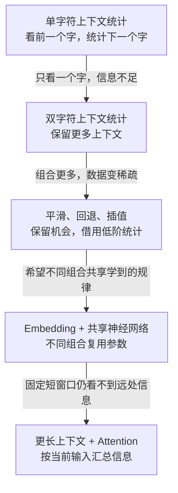
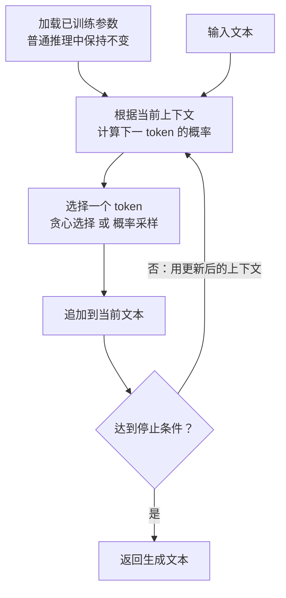
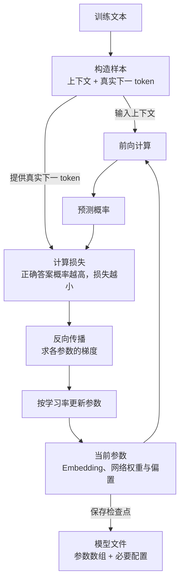
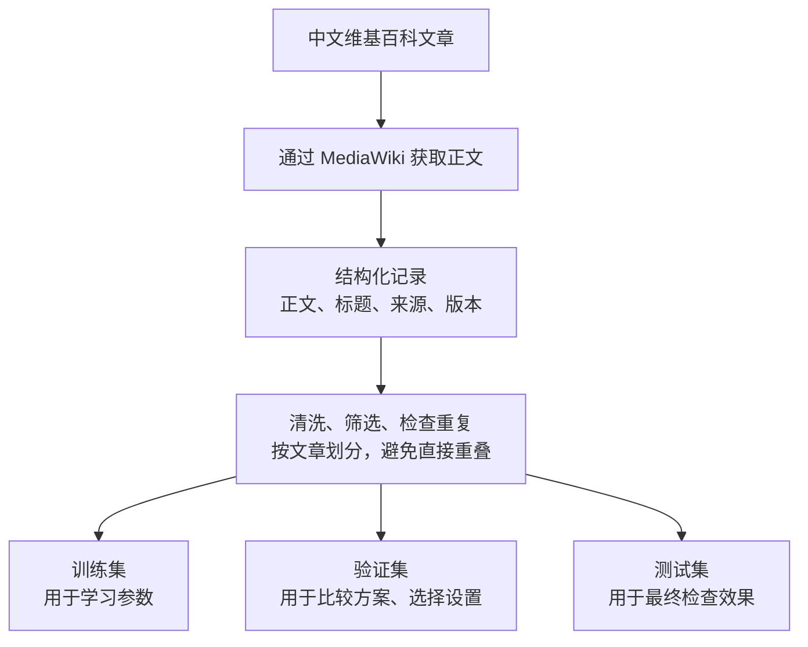
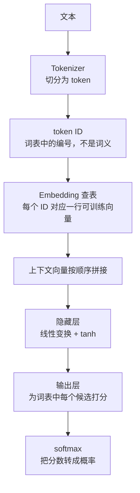
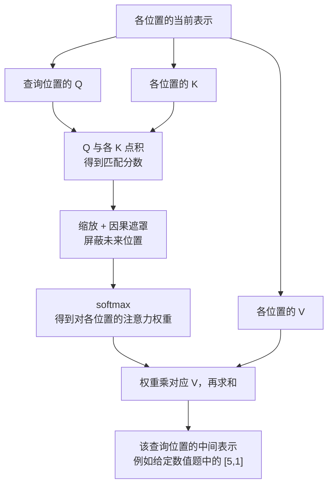
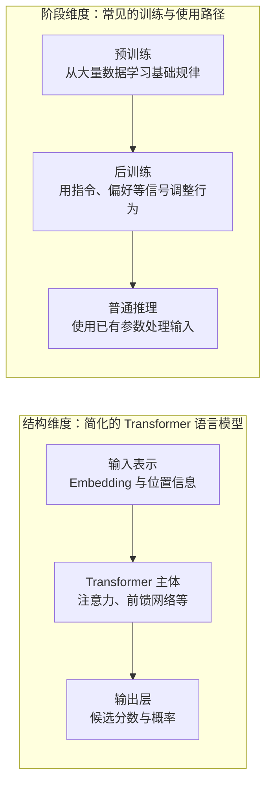

---
tags:
  - ai-main
---

# 从统计预测到注意力机制的语言模型知识体系

阅读导航：[[knowledge/00-index/home|返回AI与Agent知识首页]]。读完基础后，可进入 [[knowledge/AI Agent 学习/广告创意Agent知识图谱/AK-K04 RAG知识增强|RAG]]比较“补充上下文”和“修改参数”，或进入 [[knowledge/AI Agent 学习/广告创意Agent知识图谱/AK-K08 SFT与LoRA|SFT与LoRA]]连接训练目标与参数更新范围。以下保留原日期化讲义内容。

归档日期：2026-10-01。2026-10-02 补入七张知识示意图。面向有编程经验、正在建立 Python 与算法基础的学习者。

这段学习的主线不是记住更多术语，而是回答一个连续的问题：**怎样让程序根据已经看到的文本，预测下一个字符或 token；怎样从数据中学习；又怎样利用更长的上下文？**

本总结覆盖本项目近期实际讲解的 C01—C05 核心内容，以及分词、Word2Vec 和训练阶段的必要定位。它不是“已经独立掌握所有内容”的证明，也不是完整 Transformer 实现教程。课堂中的小数字是教学示例，不是生产模型权重或性能结论。

建议先看前三节，再按疑问回看后面的机制与例子。本文是日期化知识快照；后续课号、实际证据与接续动作，只以项目的学习进度（本分享版未收录）为准。

## 七张示意图的阅读入口

七张图已按对应主题嵌入下文，使用可编辑的 Mermaid 连线图；在支持 Mermaid 的阅读视图中显示为图形，不是单独导出的 PNG。建议先看方法演进，再对照训练与推理，其余按疑问回查。

| 图示维度 | 对应章节 | 回答的问题 |
|---|---|---|
| 方法演进 | 从旧方法的限制理解新方法 | 为什么需要新方法 |
| 推理 | 预测时发生什么 | 怎样连续生成文本 |
| 训练 | 训练时多了什么 | 参数怎样变化 |
| 数据流程 | 数据工程在这套体系中的位置 | 文章怎样变成实验材料 |
| 表示与网络结构 | 为什么要有不同的层 | 文字怎样进入计算 |
| 注意力 | 匹配和汇总是两个连续步骤 | Q、K、V 怎样协作 |
| 结构与阶段 | 模型结构与训练阶段是两条不同的轴 | 模型组件与训练过程有什么区别 |

这些图整理已有讲解，不增加本人掌握记录。方法演进图是问题驱动的关系，不是严格历史时间线；神经结构图区分本项目的小型前馈模型与用于定位的 Transformer。2026-10-01 未成功生成的整幅图片不再是阅读前提，原图稿说明（本分享版未收录）仅保留作历史材料。

## 从旧方法的限制理解新方法



| 遇到的问题 | 引入的方法 | 获得的能力 | 仍然没有保证什么 |
|---|---|---|---|
| 不知道下一个字符通常是什么 | 统计计数与条件概率 | 根据训练中出现的次数估计续接概率 | 未见组合可能被估为零概率 |
| 零概率导致怎么采样都选不到 | 平滑 | 为词表内的未见事件保留机会 | 统一加一不能判断哪种未见组合更自然 |
| 长上下文没有记录 | 回退到短上下文，或插值 | 利用更充分的低阶统计 | 回退会丢掉部分上下文信息 |
| 想利用其他组合学到的经验 | 可训练向量与共享神经网络 | 已知 token 的新组合也能参与计算 | 能算出概率不等于预测正确 |
| 随机参数没有学到语言规律 | 损失、梯度与参数更新 | 用训练样本调整表示和计算方式 | 训练损失降低不保证新数据也改善 |
| 关键人物或事实被截在输入窗口外 | 扩大可见上下文 | 让决定答案的信息进入计算 | 看得见不等于会正确利用 |
| 可见位置很多，需要结合当前输入汇总 | 注意力、因果遮罩、位置信息 | 按输入计算信息贡献，并约束可见范围与表达顺序 | 注意力不是天然正确的事实检索器 |
| 模型能运行，却不知道是否可靠 | 泛化与评测 | 用未参与训练的数据检查实际效果 | 这是后续学习入口，不是本次已完成的能力 |

最重要的三条边界是：**能输出不等于输出有用；能处理未见组合不等于泛化正确；训练表现好不等于新数据表现好。**

## 把一次预测与一次训练放在同一张流程里

### 预测时发生什么



图中的概率计算包含分词与编码、Embedding 查表、网络处理、输出打分和 softmax；各组件的关系见后面的表示与网络结构图。

重复选择 token 可以生成整段文本。普通生成过程中，输入和中间结果不断变化，但模型参数通常不更新。因此，“生成了完整文章”不等于“正在训练”。

### 训练时多了什么



同一个训练目标可以共同调整 Embedding、隐藏层、输出层等参数。训练损失不是把“随机抽出的一个字符”与答案作数值相减，而是根据模型给真实答案的概率来评价。

文件是否被改写不是训练的唯一判据：参数可以先在内存中更新，再保存。本项目先前检查权重文件指纹，是对特定预测脚本的验证，不能推广为所有程序的通用判定方法。

## 区分三类经常混在一起的对象

| 对象类别 | 例子 | 普通推理时怎样变化 |
|---|---|---|
| 编码规则与接口 | token 切分规则、词表、token ID 对应 | 通常保持与模型匹配，不随每句话重新训练 |
| 可训练参数 | Embedding 表、网络权重和偏置、W_Q/W_K/W_V | 通常固定，用于处理不同输入 |
| 当前输入的计算结果 | 查出的向量、隐藏表示、Q/K/V、注意力权重、候选分数和概率 | 随当前文本、位置与层的计算而变化 |

“权重”有两种容易混淆的用法：网络权重是保存并学习的参数；注意力权重是当前输入算出的比例。后者变化，不代表网络正在重新训练。

“模型保存什么”也因此容易理解：保存参数数组及必要配置、词表对应关系；并不需要预存所有可能句子的 Q。项目用 JSON 保存统计模型或元数据，用 NPZ 保存神经参数数组。JSON 不是大量数值参数唯一或必需的存储格式。

## 数据工程在这套体系中的位置

项目最早获取中文维基百科数据，是给后续实验准备材料，不是在训练模型。MediaWiki 接口负责取回文章导言；采集脚本将正文与标题、来源、修订版本等信息整理成记录；数据处理程序再清洗、筛选和拆分。这条线可以记作：



这是数据职责的概览，不是逐行的脚本执行顺序；各集合中的正文还需要编码成相应的训练或评测样本。

TXT 便于直接阅读正文；JSONL 一行一篇文章，保留结构化字段；manifest 记录规模、处理条件与校验值；模型文件保存学习后的统计量或参数。这些文件角色不同，不是“数据变成 JSON 就已经学会”。具体字段与来源见[项目数据说明](<../../../reference/llm-agent-lab/data/README.md>)。

已有流程把原始训练材料进一步分为训练与验证两部分，并另留测试文章。按文章 ID 不重叠能避免同一页面直接跨集合出现，但不自动证明所有重复文本、相近内容或分布偏差都已排除。下一课会系统解释为什么要保留独立检查材料，以及各类指标回答什么问题。

## 统计预测与采样

### 从计数得到条件概率

课堂例子中，“春”后面“天、风、雨”分别出现 4、2、1 次：

```text
P(天 | 春) = 4/7
P(风 | 春) = 2/7
P(雨 | 春) = 1/7
```

这里的概率是根据特定训练数据估计的，不是语言的永久真理。N-gram 使用有限长度的历史做预测。本项目口语中的“单字符模型”是看前一个字符，通常对应字符 bigram；“双字符模型”是看前两个字符，通常对应字符 trigram。不要把“上下文长度为 2”与“统计学命名的 2-gram”直接混同。

### 选择规则与模型概率是两件事

贪心选择总取最高概率候选；概率采样则让低概率候选也有机会被选中。固定同一概率分布独立采样 7 次，不保证恰好出现 4、2、1 次。概率从一开始就存在，样本频率只是有随机波动的观测。

纯计数模型中，若某事件概率是 0，增加采样次数也不能把它抽出来。要改变这种限制，需要改变概率估计方法，而不只是多抽几次。

### 平滑与回退分别改了什么

固定词表为“天、风、雨、光”时，加一平滑把计数 `[4,2,1,0]` 改为 `[5,3,2,1]`，分母也从 7 改为 11。若词表再加“桌”，分母为 12，“光”和“桌”都分得 1/12。平滑没有凭空收集到新样本，也没有仅靠这条规则学会区分两种续接的合理性。

回退的课堂例子是：未见“暖风”和“凉风”时，都使用“风”的计数表，因此两者得到相同分布。项目的硬回退是在整段上下文没有记录时缩短上下文；它不是“某个候选计数为零就自动回退”的完整 Katz 算法。

## 分词与可学习表示

### token ID 是地址而不是词义

本项目逐字符编码。假设“风”对应 ID 8，那么 ID 8 用来索引 Embedding 表的一行。ID 8 与 ID 9 数值相近，不代表对应内容语义相近。

大模型常用子词或字节级方案。BPE 可以通过反复合并高频相邻片段建立词表；准备分词器与使用分词器是不同阶段。使用时通常应用保存的规则，而不是每条输入重新训练。token 不必是完整的词，一个汉字也不保证只占一个 token。具体机制可回查 [BPE 教程](https://huggingface.co/learn/llm-course/chapter6/5)。

### 词表与模型必须配套

token→ID、输入 Embedding 的行、输出候选编号之间存在对应关系。已有模型不能只换一套词表编号却保留旧参数含义。新增 token 时，通常需要扩展输入和输出相关参数，初始化、继续训练并验证；从头训练新模型则可以重新选择分词方案。

固定分词接口不等于固定向量数值。通常先确定分词器，再让 Embedding 和预测网络联合训练；新增 token 后的配套调整见 [tokenizer 官方说明](https://huggingface.co/docs/transformers/en/main_classes/tokenizer)。

### 向量让不同组合共享学习结果

“暖阳”和“暖风”可以使用同一份“暖”的向量。训练前者时对这份表示的调整，可能影响后者。网络计算参数同样被不同样本复用，这就是处理未见组合的重要基础。

向量不是人工填写的完整字典解释，每一维也不必能被命名为一种语义。随机向量已经能进入计算，但尚未通过训练形成可依赖的语言规律。未见组合能计算，不保证其中的规律迁移有益。

Word2Vec 是学习可复用词表示的一类方法，不是 Transformer 的必需前置步骤。可以先学习表示再交给其他任务，也可以像本项目一样联合学习输入表示和下一字预测器；本轮仅定位其用途，没有完成 Word2Vec 的实现或完整推导。

## 神经预测与参数学习

### 为什么要有不同的层

本项目的小型神经模型是：



Embedding 提供表示，隐藏层组合输入，输出层为候选打分；它们是同一网络的组件。若只有连续的线性或仿射计算，可以合并。例如 `h=3x+1`、`s=2h+4` 等价于 `s=6x+6`。中间加入 tanh 等非线性后，一般不能再等价压缩成一次仿射变换。

代码中存在多层，不自动证明效果更好；数据、训练与评测仍决定结论。本项目的实际模型不是 Transformer，注意力部分目前主要通过课堂小例子讲解。

### 分数怎样变成概率

对词表中的候选分数 s，softmax 的定义是：

$$p_i=\frac{\exp(s_i)}{\sum_j\exp(s_j)}$$

它能处理正负分数，保持大小排序，并把结果归一化。所有分数一起加同一个常数，结果不变；乘同一个常数通常会改变分布的集中程度。softmax 给出合法概率，并不自动使概率准确。

课堂计算“吹”0.3、“冷”1.5，得到约 23.1% 与 76.9%。这些是两个候选范围内的教学数值，不是模型对真实中文的性能报告。

### 损失表示这条预测有多不符合目标

若真实下一字为“冷”，本例使用单样本交叉熵：

$$L=-\ln P(冷)$$

给正确答案的概率越高，这条样本的损失越小。不是所有候选分数都应趋向 0，也不是“恰好抽中正确答案”就说明损失很低。

### 梯度与学习率共同决定更新

最简单的梯度下降写为：

$$\theta_{new}=\theta_{old}-\eta\nabla_\theta L$$

θ 表示参数，η 是学习率。梯度描述当前参数附近，参数变化会怎样影响损失。各参数的梯度可以不同，不能把“降低损失”理解为“所有参数一起减小”。梯度为零也不保证到达全局最好位置。

课堂最小例子中，设 Embedding 数值 e=-0.5、网络权重 w=2，“冷”的分数为 e×w，“吹”的分数固定为 0，真实答案为“冷”：

| 操作 | 冷的分数 | 冷的概率 | 损失 |
|---|---:|---:|---:|
| 初始状态 | -1.000 | 26.9% | 1.313 |
| 只将 w 从 2 减到 1.9 | -0.950 | 27.9% | 1.277 |
| 从初值出发，学习率 0.1 联合更新 e 与 w | 约 -0.695 | 33.3% | 1.100 |

最后一行不是接着第二行更新。它使用共同初值算出两个梯度，再把 e 更新到约 -0.3538、w 更新到约 1.9634。Embedding 与网络参数在同一目标下，一增一减；换一组数值，方向也可能相同。

学习率控制步长。对教学曲线 `L=(w-1)²`，从 w=3 开始：学习率 0.25 会逐步接近最低点，1 会在 3 与 -1 之间来回跳，1.2 会越跳越远。这不是实际网络的全局损失形状，也不是通用学习率建议。我们只学习了局部方向与一步更新，没有完成多层反向传播或 Adam 推导。

## 上下文与注意力

### 参数无法补回完全没输入的信息

前文给出“小明最喜欢苹果，小红最喜欢香蕉”，后面分别问“小明最喜欢的水果是”和“小红最喜欢的水果是”。如果模型只看最后两个字符“果是”，它看不到提问对象，更看不到前面的偏好事实。

增加训练次数不能让相同的可见输入识别本次被截掉的内容。扩大上下文先解决可见性；注意力再提供按当前输入匹配并汇总各位置表示的机制。注意力不是扩大上下文的唯一方法，也不是保证事实匹配正确的规则。

### 每个位置都有自己的查询

在单层、单个头内，N 个 token 位置对应 N 个查询向量，而不是每个位置各有 N 组 Q。把这些向量按行排起来，才得到公式中的 Q 矩阵。

| 对象 | 作用 | 从哪里来 |
|---|---|---|
| Q | 当前查询位置用于匹配的表示 | 当前层的位置表示经 W_Q 变换 |
| K | 各可见位置用于匹配的表示 | 各位置表示经 W_K 变换 |
| V | 实际参与汇总的内容 | 各位置表示经 W_V 变换 |

训练的是 W_Q、W_K、W_V 等参数。Q/K/V 是当前输入计算出的结果；同层同头的变换在不同位置复用。标准多头结构会为每个头做各自的查询计算，头数属于模型结构，不随句子长度自动增加。本轮不展开多头拼接、残差或归一化细节。

### 匹配和汇总是两个连续步骤

下面只观察单层、单个头、第 i 个查询位置；每个查询位置都有自己的一组注意力权重。



每个 Q 都有自己的一组权重。K 不是人工提取的关键词，V 不是最终答案。前面用“小明相关信息”和“小红相关信息”各当一条向量，只是为了手算；真实标准自注意力通常在完整 token 位置上工作，也包括标点和重复 token 的不同出现位置。

原始 Transformer 的缩放点积注意力、因果可见范围和位置表示，可对照[论文相关章节](https://arxiv.org/html/1706.03762v7)。本笔记只保留课堂机制，不展开全部结构。

### 注意力输出不是下一字概率

| 操作 | 分配比例的对象 | 结果的用途 |
|---|---|---|
| 注意力里的 softmax | 当前查询能看到的输入位置 | 决定各 V 对汇总的贡献 |
| 输出层后的 softmax | 词表中的候选 token | 决定下一 token 的概率 |

单个注意力头产生的是各位置的中间表示。常见自回归模型使用最后一个已输入位置的最终表示，经输出层得到下一 token 分布，不需要先在未知答案位置放一个查询。更深层的位置表示已经可能包含前面层汇总的上下文，因此最后位置不再只是孤立的原始字向量。

### 因果遮罩与位置表示各管一件事

因果遮罩限制“能读取谁”：位置 i 只能读取自己及更早位置。训练时即使整句都已知，也不能让一个位置偷看它要预测的未来答案。

在 softmax 前把未来位置分数设为负无穷或做等价屏蔽，使其权重为零。把分数设为 0 不够，因为 exp(0)=1。例如 `[1,2,0]` 的第三项仍有约 9% 权重，而 `[1,2,-∞]` 的第三项为零。

位置表示帮助表达“信息在哪里”。本轮讲的是一种加法方案：token 向量加位置向量。因此“小明”出现在第 1 与第 3 个位置时，可以复用同一基础 Embedding，却得到不同的带位置信息输入。不要把这一种方案当作所有模型唯一做法，也不要把因果遮罩与位置编码视为同一件事。

### 一个加权汇总例子

观察第 2 个位置，给定 V₁=[2,4]、V₂=[6,0]、未来 V₃=[100,100]，权重为 `[0.25,0.75,0]`：

```text
0.25×[2,4] + 0.75×[6,0] + 0×[100,100]
= [0.5,1] + [4.5,0] + [0,0]
= [5,1]
```

按给定权重逐维加权求和，得到 `[5,1]`。这个向量的分量不必相加为 1；它不是概率分布。

## 模型结构与训练阶段是两条不同的轴



**结构回答由什么组成**：本项目是 Embedding 加小型前馈网络；常见 Transformer 语言模型包含输入表示、注意力与前馈模块、输出层等。Transformer 本身是神经网络，不是与神经网络并列的另一个系统。

**阶段回答何时怎样学习**：预训练形成基础能力，后训练可以用指令示范或偏好等信号继续调整模型行为。后训练不是接在 Transformer 后面的一个网络层。不同训练方案可选择更新全部或部分参数；行为更符合要求，也不意味着事实永远正确。阶段区别可参考[指令与人类反馈训练实例](https://arxiv.org/abs/2203.02155)。

当前项目实现的是小型模型，不应因为已经讲到注意力，就把代码称为完整 LLM 或完整 Transformer。检索、工具、Agent 流程属于更外层的后续主题，本轮没有新增相关掌握证据。

## 已有实验告诉了我们什么

下面只摘录仓库已有报告，没有重新训练或重新评测。它们是特定数据、模型配置和评测规则下的历史结果，不是对所有语言模型的排名，也不作为本人独立完成评测的证据。

在[统计模型报告](<../../../reference/llm-agent-lab/reports/model_evaluation.md>)中，单字符上下文的覆盖率为 99.73%，双字符上下文为 66.62%。双字符模型在已经覆盖的题上 Top-1 为 16.94%，高于单字符的 13.38%；但把全部题计入后，双字符为 11.28%，低于单字符的 13.34%。这正对应最早发现的矛盾：上下文更具体时，命中已有记录可能更准，但更容易找不到记录。两者各自覆盖的题目集合不同，因此“已覆盖 Top-1”还不能证明双字符模型在同一批题上必然更准。硬回退与插值后的整体 Top-1 分别为 16.92% 和 17.32%。

另一份[未见组合专项报告](<../../../reference/llm-agent-lab/reports/unseen_combination_evaluation.md>)只看“组成字符与答案见过、双字符组合没见过”的 1,623 道题：神经模型 Top-1 为 19.65%，硬回退为 18.42%；但神经模型 Top-5 为 40.91%，低于硬回退的 43.62%。Top-1 检查排名第一是否正确，Top-5 检查正确答案是否在前五个候选里。

因此现有实验只能支持有限结论：共享参数让未见组合可以参与预测，这次 Top-1 有所提高；不能说神经模型在所有指标上都更好。两份报告的题目范围不同，也不能直接横向比较其百分比。怎样设计和解释这样的比较，是下一课的重点。

## 三个值得自查的联系

可以用以下三个问题连接前面的机制：

1. 已知 token 组成的新组合为何能计算，以及为何仍可能算错。
2. 注意力权重、汇总向量、词表预测概率之间的区别。
3. 单条训练样本损失改善、整体训练改善、新数据泛化改善之间的区别。

完整多层求导、Adam、多头矩阵、其他位置编码、从零训练 Transformer 和后训练实现都不在本轮验收范围。

## 回到项目时从哪里查

| 想核对的问题 | 项目入口 |
|---|---|
| 计数、回退、插值 | [统计模型](<../../../reference/llm-agent-lab/ngram_language_model.py>) |
| 词表、向量、前向、损失与更新 | [神经模型](<../../../reference/llm-agent-lab/neural_language_model.py>) |
| 训练与预测入口的区别 | [训练入口](<../../../reference/llm-agent-lab/train_neural_model.py>) 与 [预测入口](<../../../reference/llm-agent-lab/predict_neural.py>) |
| 新组合能否预测得更好 | [未见组合评测](<../../../reference/llm-agent-lab/evaluate_unseen_combinations.py>) |
| 不熟悉的 Python 语法与数组形状 | [代码阅读指南](<../../../reference/llm-agent-lab/docs/code-reading-guide.md>) |

本次整理不重训、不替换任何已有模型或评测基线。知识图用于快速定位，本文用于理解条件，项目进度用于记录真实学习证据。
