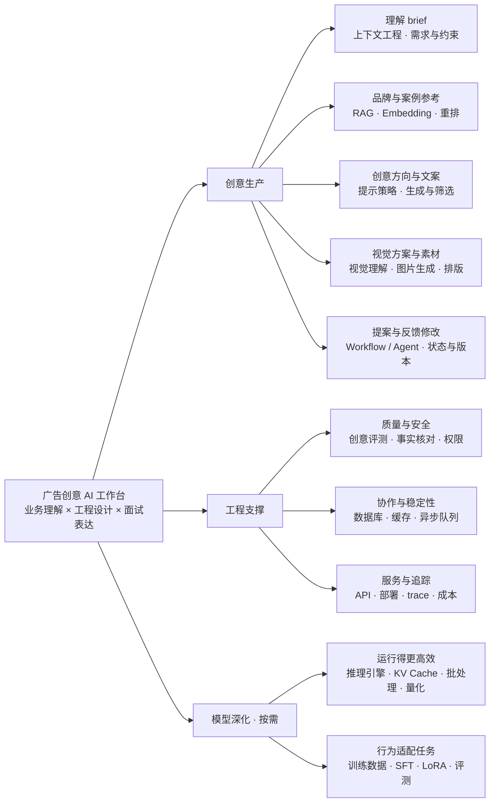
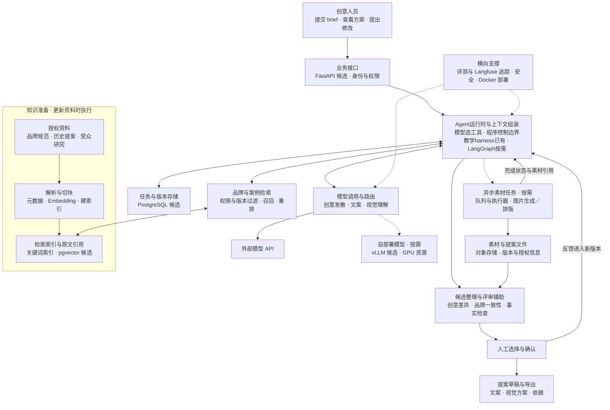

# 广告创意AI工作台整体地图与技术架构

更新：2026年11月1日。用途：把熟悉的广告创意业务与AI工程知识联系起来，并作为架构面试的讲解提纲。

两张图表达目标能力与候选架构，不表示所有组件已经部署。实现主线是[广告创意Agent服务](<../creative_agent/README.md>)：模型通过工具调用决定下一步，程序提供有状态且有权限边界的执行环境。已有本地HTTP服务、SQLite快照／事件、独立评审上下文、预算与恢复机制，以及DeepSeek工具调用适配；现增加可选BM25检索、父段返回、版本／商品范围过滤和证据快照。离线与本地接口验证已有，真实API闭环仍待核验。语义Embedding、混合检索、模型重排、第三方编排框架、图片生成和生产部署平台尚未实现。实际状态统一见学习进度（本分享版未收录）。

## 整体地图

连线表示能力归属，不表示每次请求的执行顺序。以广告创意生产为中心，工程支撑和模型深化服务于它，而不是把审核当成全部业务。

面试时用同一框架解释每个节点：业务问题是什么、技术机制是什么、为什么这样选、有哪些代价、怎样验证。理解模型原理贯穿这些解释，不必把从零训练模型作为所有应用的前置条件。

## 技术架构地图

实线表示主要请求或数据连接，双向线表示请求与结果／状态交互，虚线表示按需启用的扩展或横向支撑。具体选型是候选；图中的逻辑模块可以先放在同一个服务中，不等于必须拆成多个微服务。两个PostgreSQL相关节点表示不同数据职责，可以共用实例。

### 读图时区分的边界

- 知识准备发生在资料导入或更新时，不是每个请求重新把全部资料切块和建索引。线上检索返回相关片段与来源，再由上下文组装环节送给模型。
- RAG是方法，Embedding模型负责表示，pgvector是可选检索组件。资料少时也可直接提供适用内容，不强制引入向量检索。
- LangGraph是编排候选，不是模型；固定流程也可以不用Agent框架。MCP若后续采用，位于外部工具／资料连接边界，是协议，不替代任务编排和授权检查。
- 外部API与自部署是模型服务的不同接入路径，可择一或按任务组合。自部署、GPU和图片任务都不是首轮必需。图中的vLLM只作为语言／兼容视觉理解模型服务候选，图片生成引擎另行选型。
- 任务队列安排异步工作，缓存用于复用合适的结果，数据库保存持久状态；三种职责不同。需要时再引入Redis等组件，并设计过期、隔离和可靠性边界，不为凑技术栈而全部部署。
- 图中的模型调用可发生多次，评审需要语义理解时也可复用模型服务。人工确认决定创意取舍，模型评分仅作辅助；创意评分不能直接代表真实投放收益。
- SFT／LoRA属于离线模型适配分支，不放在每次创意请求的必经链路中。需要有经核对的训练数据、独立评测与版本发布，不把客户反馈直接自动训练入模。

## 当前材料与规划能力

| 范围 | 当前状态 |
|---|---|
| 杯子示例、任务组装、优惠价格规则 | 局部教学代码与离线测试已有，不等于创意工作台已完成 |
| DeepSeek模型提取入口 | 接口代码与mock测试已有；真实调用及模型质量仍待核验 |
| 广告创意Agent本地服务 | 工具循环、独立评审、SQLite状态与事件、HTTP接口已有；模拟／接口测试通过，真实模型闭环未实测 |
| 品牌／案例RAG | 本地词项检索与父段返回已接入；任务资料快照、来源、引文校验及教学开发对照已有；语义检索／重排、账号ACL与真实模型收益未验证 |
| 第三方持久编排、完整评测平台 | 图中规划，尚未接入；本地运行时已有SQLite持久状态 |
| 图片生成、素材协作、完整服务部署、自部署推理和微调 | 按需扩展，不作为已完成经历 |

## 面试讲解提纲

“我会围绕brief到提案修改的创意流程设计系统。业务接口接收需求，编排层组织品牌资料、历史参考和模型调用；知识检索负责提供有版本与权限边界的依据，模型负责创意发散与内容展开。较慢的素材任务可以异步处理，任务和反馈保留版本。最终由人选择创意方案，系统提供评审辅助、事实检查和追踪。先通过简单基线验证，再按质量、延迟和成本决定是否引入更复杂的编排、自部署或微调。”

这是拟议设计的参考表达，不是上线经历陈述。图中的每个组件都应该能回答“为什么需要”和“什么时候不用”。

## 官方技术定位参考

- [FastAPI](https://fastapi.tiangolo.com/)：业务API框架。
- [LangGraph](https://docs.langchain.com/oss/python/langgraph/overview)：有状态任务编排与人工介入。
- [pgvector](https://github.com/pgvector/pgvector)：PostgreSQL向量相似搜索。
- [vLLM](https://github.com/vllm-project/vllm)：模型推理与服务引擎。
- [Langfuse](https://langfuse.com/docs)：调用追踪与评测。
- [MCP](https://modelcontextprotocol.io/docs/2026-07-28/getting-started/intro)：AI应用与外部系统的连接协议。

技术定位依据已查阅的官方说明，候选架构是本项目的教学设计，不是上述工具官方规定的唯一组合。具体版本、许可与兼容性在实现前另行核对。
