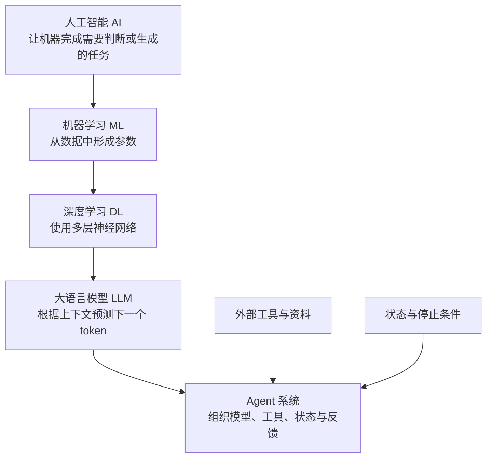
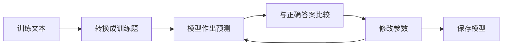
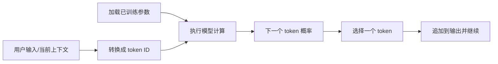

# C01：一段文本怎样变成模型预测

课时定位：第 1 周第 1 节，约 45 分钟。当前只建立全局位置和一条完整数据流，不展开概率公式、反向传播或 Transformer 内部结构。

## 本课要回答的问题

```text
一段文本如何变成训练题目、模型参数，最后又怎样被用来产生预测？
```

完成本课后，应当能够指出：

1. 训练数据在哪里进入流程；
2. 模型参数在哪里形成；
3. 使用模型时哪些内容会变化、哪些不会变化；
4. 大语言模型和 Agent 分别位于整个系统的什么位置。

## 1. 先放进 AI 全景中



这张图表达“本项目从哪里切入”，不是严格的集合证明。需要保留两个边界：

- AI 不只有大模型。表格分类、图像识别、推荐和聚类都可能使用其他方法。
- Agent 不是一种更大的语言模型。它是一个系统，可以调用语言模型，也可以调用搜索、文件、计算器等工具。

本项目当前已经实现了两种很小的语言模型：N-gram 统计模型和前馈神经语言模型。它们与真实大模型规模差距很大，但都保留了同一核心任务：根据上下文给下一个 token 分配概率。

## 2. 必须分开的两条路径

### 训练路径：形成参数



训练阶段会修改参数。N-gram 的参数是计数；神经网络的参数是大量矩阵中的浮点数。

### 使用路径：读取参数



普通预测阶段只读取参数，不会因为问了一次问题就自动重新训练。用户输入会改变“本轮上下文”，但不会自动改变模型文件里的参数。

## 3. 用三句文本走完整条链

本课只使用：

```text
中国人
中国家
中华人
```

上下文长度设为 2，程序把文本拆成三道题：

| 训练输入 | 正确答案 |
|---|---|
| 中国 | 人 |
| 中国 | 家 |
| 中华 | 人 |

对 Trigram 来说，训练形成的参数可以直接写出来：

```python
{
    "中国": {"人": 1, "家": 1},
    "中华": {"人": 1},
}
```

这一步需要区分四种对象：

| 对象 | 当前例子 | 是否由训练修改 |
|---|---|---:|
| 原始数据 | `"中国人"` | 否 |
| 训练题 | `"中国" → "人"` | 是由数据转换得到 |
| 模型参数 | `"中国" → {"人": 1, "家": 1}` | 是 |
| 一次预测 | `P("人"｜"中国") = 50%` | 只读取参数 |

运行微型演示：

```bash
python3 lessons/c01_trace.py
```

预期观察顺序是“原始数据 → 三道题 → 两行参数 → 两个 50% 候选”。这个脚本不读取正式语料，也不会覆盖项目中已经训练好的模型。

## 4. 对应到现有项目

统计模型主线：

```text
main.py
  ├─ prepare_dataset_splits()     准备训练集和验证集
  ├─ load_documents()             读取正文
  ├─ train_*_model()              由正文形成计数参数
  ├─ save_model()                 保存参数 JSON
  ├─ load_model()                 重新加载参数
  └─ generate_text()              反复预测下一个字符
```

神经模型主线：

```text
train_neural_model.py
  ├─ build_vocabulary()           字符和整数 ID 建立对应关系
  ├─ build_training_examples()    生成 X 和 y
  ├─ FeedForwardLanguageModel()   创建参数矩阵
  ├─ train_model()                根据错误更新参数
  └─ save_neural_model()          保存 NPZ 权重和 JSON 说明

predict_neural.py
  ├─ load_neural_model()          读取已有参数
  ├─ encode_text()                当前输入变成 ID
  └─ predict_probabilities()      只做前向计算，输出概率
```

本课只需要看懂函数在流程中的位置，不要求进入 `train_model()` 阅读完整反向传播。

## 5. 统计模型、神经模型和真实大模型

| 对比项 | 当前 N-gram | 当前神经模型 | 真实大语言模型 |
|---|---|---|---|
| 基本任务 | 预测下一个字符 | 预测下一个字符 | 预测下一个 token |
| 参数如何形成 | 增加计数 | 根据损失更新矩阵 | 大规模神经网络训练 |
| 上下文 | 0、1 或 2 个字符 | 固定 2 个字符 | 通常可处理很长 token 序列 |
| 参数存储 | 可读 JSON | NPZ 矩阵 + JSON 说明 | 大型分片权重文件与配置 |
| 未见组合 | 回退或插值 | 共享向量和网络参数 | 依靠分布式表示和上下文计算泛化 |

共同点让小模型可以解释大模型的核心任务；差异提醒我们不能把当前实验成绩直接推广成真实大模型能力。

## 6. B01—B03 全景补充，到这里就停

- B01 经典机器学习：如果任务是根据表格预测价格或类别，不一定需要生成式大模型。
- B02 其他模型结构：CNN、RNN、Transformer 等结构决定信息怎样参与计算；本课只知道它们位于“模型结构”这一层。
- B03 数据工程：清洗、去重和训练/验证/测试拆分决定模型究竟见过什么；数据泄漏会让评测虚高。

本课不要求记忆算法清单。只需知道：任务、数据和需要利用的信息结构共同决定该选什么方法。

## 7. 本课唯一的理解核验

先不要运行代码，回答下面一个问题：

> 已经训练并保存好模型后，只把 `python3 predict_neural.py 种基` 改成 `python3 predict_neural.py 元通`，训练数据、模型参数、当前上下文和预测结果中，哪些会改变，哪些不会改变？为什么？

请用自己的话回答即可，不需要使用“推理”“前向传播”等术语。收到回答后再运行两个命令核对。

## 8. 本课停止位置

本课学到这里即可：训练通过数据形成参数，使用阶段把当前上下文交给固定参数得到预测；Agent 位于模型外部，负责组织模型和工具。

下一课 C02 才会手算 `"中国" → {"人": 1, "家": 1}` 如何变成概率，并比较“总选第一名”和“按概率采样”。
